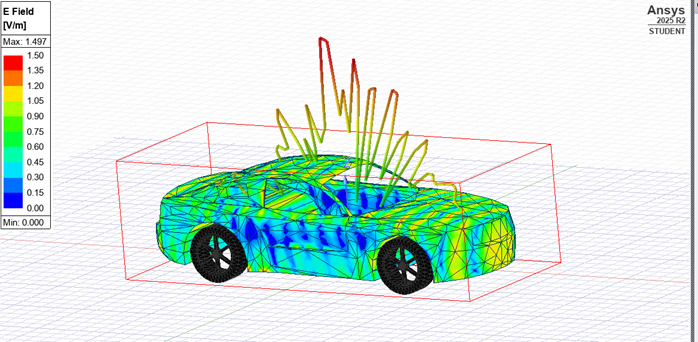
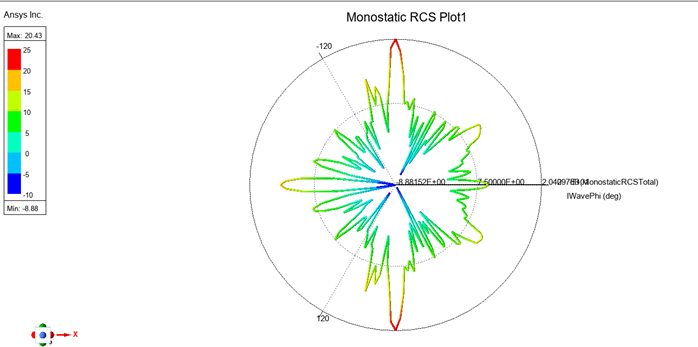

# Digital-twin-car_RCS

Для расчета ЭПР автомобиля использовался метод FE моделирования, в ограниченной области. В качестве материала, из которого состоит автомобиль, был выбран идеальный проводник (perf E). При этом колеса в расчетах не учитывались. На автомобиль была направлена падающая волна с частотой 711 МГц. Расчеты были проведены отдельно для плоскости phi( от 0 до 360 градусов, с шагом 2 градуса)  и theta ( от -90 до 90 градусов, с шагом 2 градуса). 
Установить частоту в 1 ГГц не удалось из-за ограничений student версии Ansys electronics, поэтому была установлена частота 610 МГц.

 Диаграмма рассеяния в горизонтальной плоскости:

 Диаграмма рассеяния в вертикальной плоскости: 

